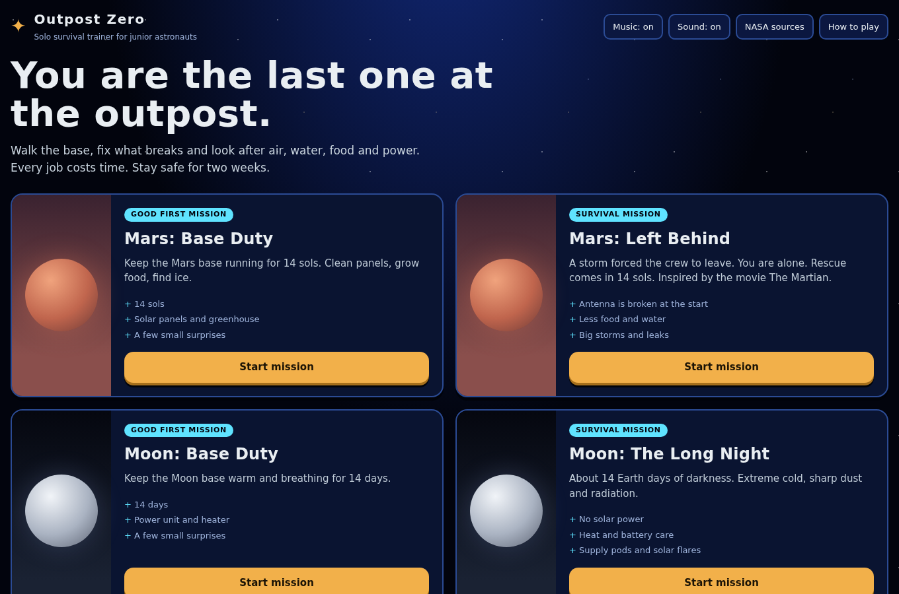
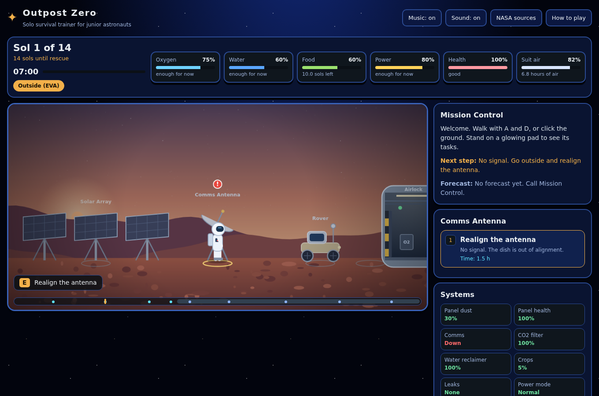
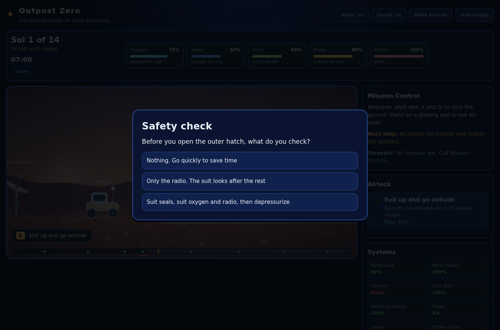
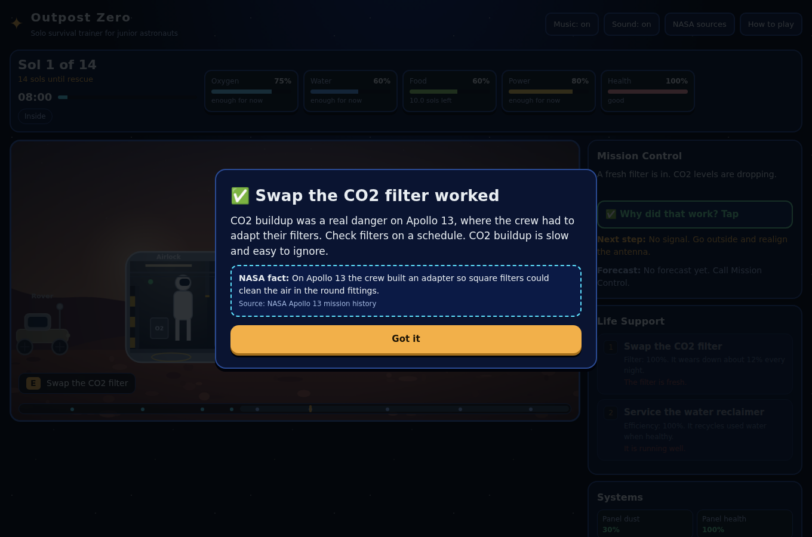
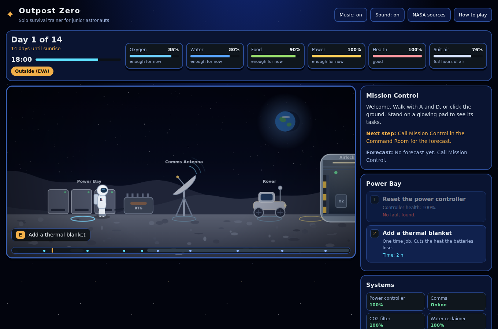
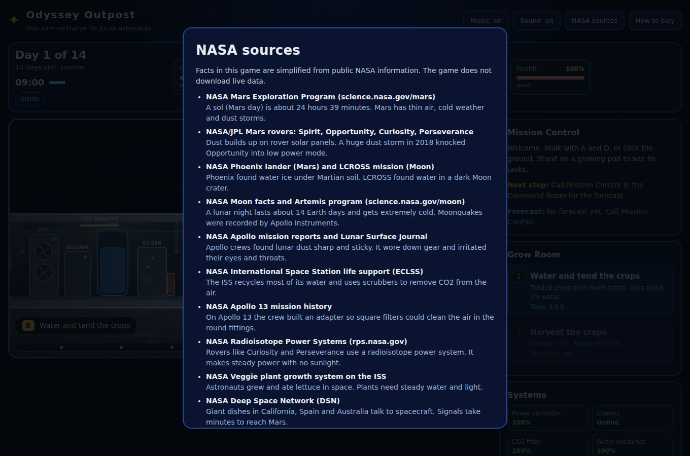
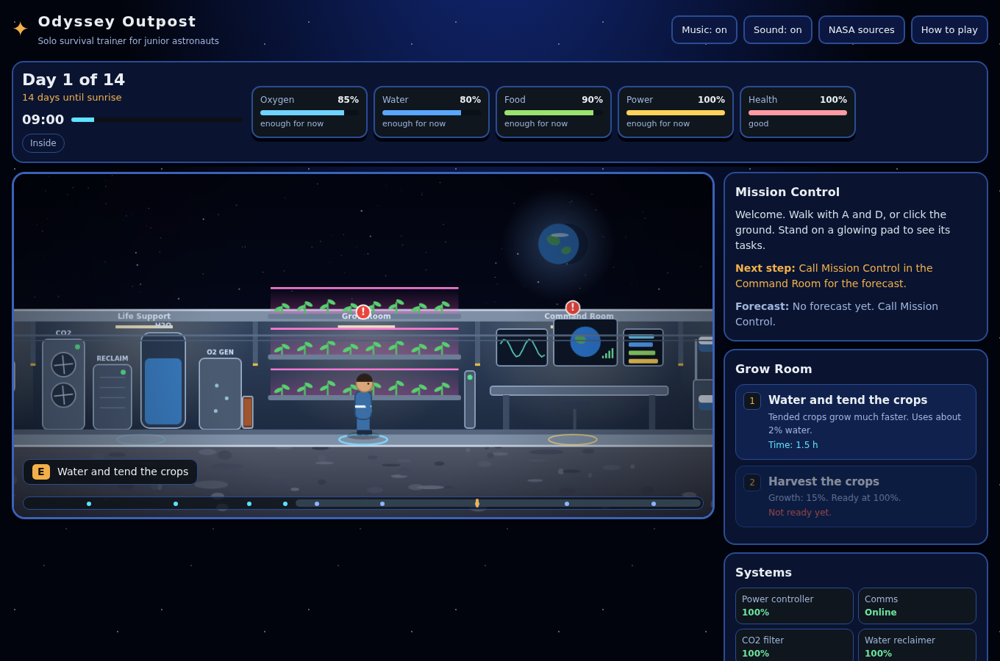

# Odyssey Outpost

**A 2D survival trainer for junior astronauts. Alone on the Moon or Mars for two weeks, can you keep the outpost alive?**

Built by team **Cosmic Odyssey** for the **NASA Space Apps Challenge 2026**.

| | |
|---|---|
| **Live game** | 👉 **[https://sino-cant-code.github.io/Outpost-Zero-NASA-Space-App-Challange-2026/]**|
| **Challenge** | [Build a Junior Astronaut Mission Trainer] |
| **Team** | [Odyssey Outpost] |

---

## Screenshots

Screenshots taken from the game itself.

---|---|
|  |  |

| Safety check | "Why?" explanation |
|---|---|
|  |  |

| Moon night | NASA sources |
|---|---|
|  |  |

| Greenhouse |
|---|
|  |

---

## The idea

Future astronauts must stay calm and make safe choices when things go wrong. Odyssey Outpost lets young learners practise that. Every job costs time, every choice has a result, and after each result the game explains **why**.

## Features

- **4 missions:** Mars Base Duty, Mars: Left Behind, Moon Base Duty, Moon: The Long Night.
- **Two-week simulation:** 14 sols on Mars, 14 days on the Moon.
- **Left Behind scenario:** the crew is gone and your antenna is broken. It is inspired by the movie *The Martian* (a movie, not NASA).
- **Real tasks:** clean solar panels, grow and harvest crops, drill for water ice, swap CO2 filters, fix leaks and realign the antenna.
- **Time is a resource:** walking, suiting up and repairs all use hours.
- **Safety checks:** quick questions before risky jobs, like lockout before touching moving equipment.
- **"Why?" button:** after any success, failure, alert or blocked action, tap it to learn why it happened, with a NASA fact.
- **Random events:** dust storms, leaks, solar flares, moonquakes, power and heater faults. Mission Control gives forecasts.
- **Mission report:** a score, rank and a list of what you faced and what it teaches.
- **Space sound:** music and effects are made in the browser. No audio files.
- **Simple and short text,** made for young learners. Works with keyboard, mouse and touch.

## How to play

1. Pick a mission on the start screen.
2. **Walk** with `A` / `D`, the arrow keys, or click the ground (touch buttons on phones).
3. Stand on a **glowing pad** and press `E` (or pick a task on the right, or press `1`–`4`).
4. Watch the meters: **Oxygen, Water, Food, Power, Health**, and **Suit air** when outside.
5. Follow **Next step** in Mission Control. A red **!** shows what needs attention.
6. Go back through the **airlock** before suit air runs out. Stay inside during solar flares.
7. Sleep in **Crew Quarters** to end the day. Things change overnight.
8. Tap **Why?** to learn from every result.
9. Survive all 14 days to complete the mission.

## NASA data sources

Facts in the game are simplified from public NASA information. The game does not download live data.

| Topic in the game | NASA source | Link |
|---|---|---|
| Sol length, thin air, Mars dust storms | NASA Mars Exploration | https://science.nasa.gov/mars/ |
| Lunar night, cold, Moonquakes | NASA Moon | https://science.nasa.gov/moon/ |
| Dust on solar panels, 2018 storm | NASA/JPL Mars rovers | https://science.nasa.gov/mars/ |
| Water ice | NASA Phoenix lander and LCROSS | https://science.nasa.gov/mars/ and https://science.nasa.gov/moon/ |
| Power with no sunlight | NASA Radioisotope Power Systems | https://rps.nasa.gov/ |
| Water recycling, CO2 removal | NASA International Space Station | https://www.nasa.gov/international-space-station/ |
| Growing plants in space | NASA Veggie on the ISS | https://www.nasa.gov/international-space-station/ |
| Signal to Earth | NASA Deep Space Network | https://www.jpl.nasa.gov/missions/dsn |
| Solar flares, radiation | NASA Sun / space weather | https://science.nasa.gov/sun/ |
| Lunar dust, Apollo 13 CO2 filter | NASA Apollo history | https://www.nasa.gov/ (search "Apollo 13", "lunar dust") |
| Spacewalk safety, sleep and health | NASA Human Research and EVA training | https://www.nasa.gov/humans-in-space/ |


The in-game **NASA sources** button shows the same list.

*Odyssey Outpost is an educational project. It is not an official NASA product and not real mission guidance. Values are simplified for play.*


## Project files

```
index.html
outpost-zero-single.html
css/style.css
js/data.js     missions, events, tasks, NASA sources
js/audio.js    sound (Web Audio API)
js/render.js   2D canvas drawing
js/game.js     rules, interface, main loop
docs/screenshots/   your screenshots
```


## Built with

HTML, CSS and plain JavaScript. Canvas for graphics and the Web Audio API for sound. No libraries.
